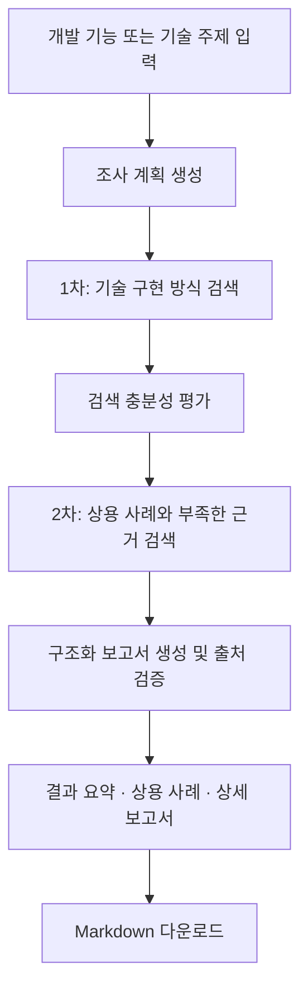

# Engineering Research Agent

**개발하고 싶은 기능을 입력하면 구현 방법과 상용 프로그램 사례를 조사해 주는 Streamlit 기술 조사 에이전트입니다.**

어떤 방식으로 구현할 수 있는지, 실제 개발에 필요한 처리 흐름·구현 단계·선택 기준을 정리합니다. Claude 또는 OpenAI의 웹 검색으로 근거를 수집하고, 결과를 화면과 Markdown 보고서로 제공합니다.

AI 서비스 엔지니어링 트랙 A 프로젝트입니다. 기본 제공자는 **Claude (Anthropic)**이며, 환경변수로 OpenAI를 선택할 수 있습니다.

## 어떤 결과를 얻을 수 있나요?

예를 들어 다음과 같이 입력합니다.

```text
이미지 누끼 따는 기능을 구현하고 싶어. 구현 방법과 상용 프로그램 사례를 조사해줘.
```

보고서는 조사 계획보다 **결과를 먼저** 보여줍니다.

1. **조사 결과 · 구현 방식 요약** — “구현 방식에는 크게 A, B, C 등이 있습니다.”라는 개요와 방식별 처리 흐름·구현 단계·적합한 상황·권장 시작점
2. **상용 프로그램 사례와 적용 설계** — 제품별 확인된 기능, 공개된 구현 방식, 우리 서비스에 적용할 설계 제안, 근거 상태와 출처
3. **상세 기술 조사** — 조사 계획·검색 이력·요구사항, 아키텍처와 장단점, 비교·권장안, 위험, 구현·검증 계획, 체크리스트와 근거 한계
4. **Sources 및 검색 근거** — 검색 API가 반환한 출처와 클릭 가능한 인용

누끼 기능이라면 외부 API 연동·서버 자체 호스팅·브라우저/온디바이스 추론 같은 접근을 검토할 수 있습니다. 이는 조사 관점의 예시이며, 실제 보고서와 확인 가능한 제품 사례는 검색 근거에 따라 달라집니다.

상용 제품의 내부 알고리즘이나 모델이 공개되지 않았으면 **내부 구현 비공개/미확인**으로 표시합니다. 우리 서비스에 적용할 아이디어는 설계 제안으로 작성하고, 근거를 확보하지 못한 내용은 미확인 또는 보고서 한계에 남깁니다.

## 주요 기능

- Claude Messages API 또는 OpenAI Responses API로 기술 조사
- 공식 문서·기술 문서·논문을 우선하는 조사 계획과 웹 검색
- **1차 기술 구현 방식 조사 → 충분성 평가 → 2차 상용 사례 및 부족한 근거 조사**
- Pydantic으로 검증하는 구조화 보고서와 방식별 구현 단계
- 상용 사례 비교 및 검색 출처와의 URL 연결 검증
- 결과 중심 UI와 동일한 순서의 Markdown 다운로드
- 다크 모드 토글, 단계별 진행 상태, 마지막 결과 유지
- Claude 스키마 호환 처리 및 실패 단계·종료 사유 안내

## 실행 흐름



정상 완료 경로는 모델 요청 5단계이며, 검색은 최대 2라운드·라운드당 도구 사용 1회로 제한합니다. 상용 사례 조사를 위해 두 번째 검색도 수행합니다. 중간 오류가 발생하면 그 단계에서 종료하며 SDK 자동 재시도와 다른 제공자로의 자동 전환은 사용하지 않습니다.

## 설치

Python **3.12 이상**이 필요합니다. Windows PowerShell에서:

```powershell
git clone https://github.com/Morgan-EE/2026-ai-service-engineering-a.git
cd 2026-ai-service-engineering-a
python -m venv .venv
.\.venv\Scripts\python.exe -m pip install -r requirements.txt
```

가상환경의 Python을 직접 사용하므로 `Activate.ps1` 실행이나 전역 Python의 Streamlit 설치가 필요하지 않습니다.

macOS / Linux:

```bash
python3 -m venv .venv
.venv/bin/python -m pip install -r requirements.txt
```

## API 설정

앱은 **실행 프로세스의 환경변수**를 읽습니다. API 키는 코드·설정 파일·Git에 넣지 않습니다. `.env.example`은 변수 이름 참고용이며 앱이 `.env` 파일을 자동으로 불러오지는 않습니다.

| 제공자 | `RESEARCH_PROVIDER` | 필요한 키 | 선택 모델 환경변수 | 코드의 기본 모델 |
| --- | --- | --- | --- | --- |
| Claude (기본) | `anthropic` 또는 `claude` | `ANTHROPIC_API_KEY` | `ANTHROPIC_MODEL` | `claude-sonnet-5-5` |
| OpenAI | `openai` | `OPENAI_API_KEY` | `OPENAI_MODEL` | `gpt-4.1-mini` |

선택한 제공자의 키만 필요합니다. 실제 조사를 실행하면 해당 제공자의 API·검색 사용 요금이 발생할 수 있습니다.

### PowerShell에서 키를 가려서 입력하기

아래 예시는 키를 현재 PowerShell과 그 하위 앱 프로세스에만 설정합니다. 키는 입력 프롬프트에 넣습니다.

```powershell
$env:RESEARCH_PROVIDER = "anthropic"
$researchSecureKey = Read-Host "ANTHROPIC_API_KEY" -AsSecureString
$researchKeyPtr = [Runtime.InteropServices.Marshal]::SecureStringToBSTR($researchSecureKey)
try {
    $env:ANTHROPIC_API_KEY = [Runtime.InteropServices.Marshal]::PtrToStringBSTR($researchKeyPtr)
}
finally {
    [Runtime.InteropServices.Marshal]::ZeroFreeBSTR($researchKeyPtr)
    $researchSecureKey.Dispose()
    Remove-Variable researchSecureKey, researchKeyPtr
}
```

OpenAI를 사용할 때는 `RESEARCH_PROVIDER` 값을 `openai`로 하고 키 변수 이름을 `OPENAI_API_KEY`로 바꿉니다.

### Windows 사용자 환경변수를 이미 설정한 경우

새 PowerShell 창에서 다음과 같이 사용자 환경변수를 현재 프로세스로 읽을 수 있습니다. 키 값을 출력하지 않습니다.

```powershell
$env:RESEARCH_PROVIDER = [Environment]::GetEnvironmentVariable("RESEARCH_PROVIDER", "User")
$env:ANTHROPIC_API_KEY = [Environment]::GetEnvironmentVariable("ANTHROPIC_API_KEY", "User")
```

Windows 사용자 환경변수는 계정에 지속 저장됩니다. 앱을 실행한 뒤 환경변수를 바꿨다면 앱을 종료하고 다시 실행해야 반영됩니다.

## 실행 및 시연

프로젝트 폴더에서:

```powershell
.\.venv\Scripts\python.exe -m streamlit run app.py
```

macOS / Linux:

```bash
.venv/bin/python -m streamlit run app.py
```

기본 주소는 [http://localhost:8501](http://localhost:8501)입니다. 포트가 이미 사용 중이면 실행 창에 표시되는 주소를 확인하세요.

상단 제공자 표시 확인 → 기술 주제 입력 → **Generate Research Report** → 구현 방식 요약과 상용 사례 확인 → 상세 보고서·Sources 확인 → **Markdown 다운로드** 순서로 시연합니다.

다운로드 파일명은 `engineering-research-report.md`입니다. 화면의 핵심 결과·상용 사례·기술 분석·출처를 함께 내보냅니다. 실행 창에서 `Ctrl+C`를 누르면 앱을 종료할 수 있습니다.

## 실행 제한과 출처 정책

| 항목 | 현재 코드 설정 |
| --- | --- |
| 최대 검색 라운드 / 라운드당 도구 사용 | 2 / 1 |
| SDK 자동 재시도 | 0 |
| 기본 API 대기 시간 | 45초 |
| Claude 계획 / 충분성 평가 출력 한도 | 2,048 / 1,536토큰 |
| Claude 검색 출력 한도 | 라운드당 4,096토큰 |
| 최종 보고서 출력 한도 | 23,184토큰 |
| Claude 보고서 작성 대기 시간 | 최대 600초 |

보고서 한도는 참고 문서의 로컬 토큰 추정치 15,456에 50% 여유를 더한 값입니다. Claude의 정확한 토큰 수를 측정한 값은 아니며 실제 출력 길이가 항상 한도에 도달하는 것은 아닙니다.

- 출처 목록은 모델 본문에서 URL을 추출해 만들지 않고 검색 API의 메타데이터에서 수집합니다.
- OpenAI는 `url_citation`과 `web_search_call.action.sources`, Claude는 검색 결과 블록과 인용의 URL을 사용합니다.
- HTTP(S) URL을 수집하고 중복을 제거합니다. 최종 검색 결과에 출처나 인라인 인용이 없으면 보고서 생성을 중단합니다.
- 상용 사례의 출처 URL은 수집한 메타데이터 안에 있어야 합니다. 미확인 사례를 제외하면 사례별 근거 URL도 필요합니다.
- URL 확인이 모든 주장과 출처의 의미를 자동 대조한다는 뜻은 아닙니다. 중요한 기술 선택·라이선스·가격 정보는 연결된 공식 자료로 재확인해야 합니다.
- 제한된 검색으로 모든 경쟁 제품·벤치마크·가격·운영 정책을 확인하지 못할 수 있습니다. 미확인 항목은 보고서에 표시합니다.

## 오류 점검

| 증상 | 점검 방법 |
| --- | --- |
| `No module named streamlit` | `.\.venv\Scripts\python.exe` 사용 및 의존성 설치 확인 |
| API 키 환경변수 누락 | 선택한 제공자에 맞는 키를 실행 PowerShell에 설정하고 앱 재시작 |
| `AuthenticationError` | 해당 제공자의 유효한 API 키인지 확인 |
| Claude HTTP 400 | 표시된 실패 단계와 스키마·모델·웹 검색 설정 안내 확인 |
| `max_tokens` | 출력 한도에서 응답이 잘린 상태. 부분 보고서를 정상 결과로 사용하지 않음 |
| `refusal` / `pause_turn` / `empty_text` | 표시된 종료 사유 확인. 앱은 자동 재요청하지 않음 |
| 출처 또는 인라인 인용 누락 | 조사 범위를 구체화하고 공식 자료를 찾을 수 있는 주제로 조정 |
| 시간 초과 | 인터넷 연결·제공자 상태·조사 범위·실행 창 로그 확인 |

## 로컬 검증

```powershell
.\.venv\Scripts\python.exe -m pytest -q
.\.venv\Scripts\python.exe -m compileall -q app.py src tests
```

2026-10-24 기준 **37개 테스트 통과**, 컴파일 검사 및 Streamlit 로컬 HTTP 200 응답을 확인했습니다. 테스트는 Mock/Stub과 메모리 HTTP 전송기를 사용하며 실제 유료 모델 API를 호출하지 않습니다. Claude 회귀 테스트는 외부 소켓 연결을 차단하고 화면 테스트에 필요한 Windows 내부 루프백 연결만 허용합니다.

Claude 스키마 변환·종료 사유·검색 상한·상용 사례 출처 검증·Markdown 구성·Streamlit 보고서 표시를 로컬에서 검증합니다. 최신 상용 사례 조사 흐름의 실제 API 품질 검증은 이 테스트 결과와 별개입니다.

## 프로젝트 구성

| 파일 | 역할 |
| --- | --- |
| `app.py` | 입력·진행 상태·보고서·다크 모드·다운로드 |
| `src/web_research.py` | 제공자 선택, 계획·검색·평가·보고서, 출처와 오류 처리 |
| `src/models.py` | 계획·구현 방식·상용 사례·보고서 데이터 모델 |
| `src/markdown_export.py` | 결과 요약·상용 사례 표·상세 보고서의 Markdown 변환 |
| `src/mock_report.py` | 과거 Mock 예제 및 호환성 회귀 테스트용 데이터 |
| `tests/test_anthropic_research.py` | Claude 요청·스키마·종료 사유·상용 출처·화면 검증 |
| `tests/test_web_research.py` | OpenAI 경로, 검색 상한·출처·오류 처리 검증 |
| `tests/test_markdown_export.py` | 결과 순서·상용 사례·출처·Markdown 출력 검증 |
| `requirements.txt` | Python 의존성 |
| `.env.example` | 환경변수 이름과 기본값 예시 |

로그인·조사 이력 DB·RAG·벡터 DB·멀티 에이전트·서비스 배포는 현재 구현 범위에 포함하지 않습니다.
